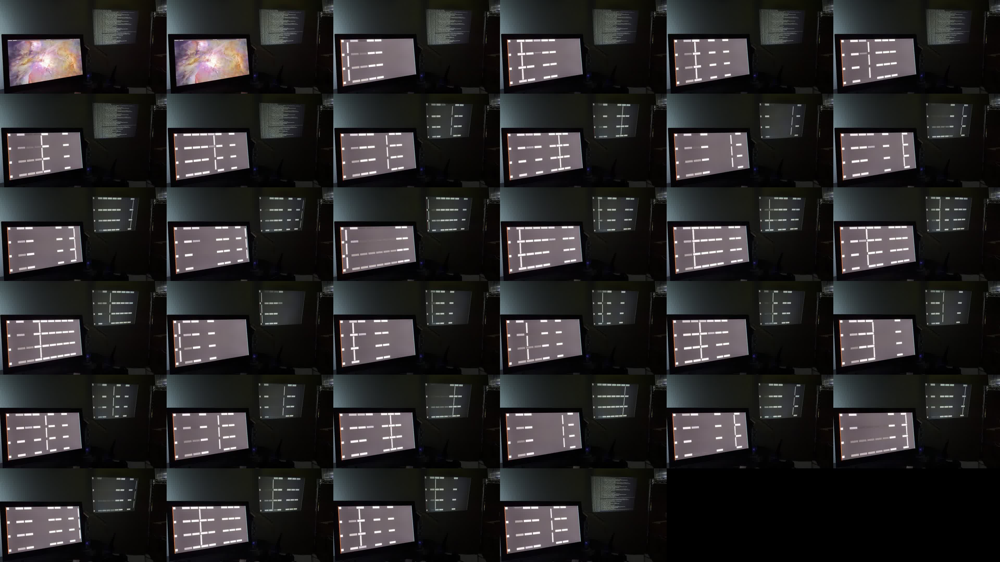

# Native 720p source-screen-to-projector optical latency

This gate films the mirrored 60 Hz frame-ID pattern on the host's DP-2 display
and on the projector in one slow-motion view. It closes the optical cross-check
left open by the capture-completion-to-physical-vsync measurement. The operator
reported that the pattern and console restoration both looked correct.

## Accepted run

The visible run used:

```text
python3 tools/hdmi/run-native-720-panel.py \
  --camera-ready --frames 480 --pattern-only --mirror-from DP-2
```

The runner temporarily mirrored `HDMI-A-1` from `DP-2`, waited one second for
the lossless pattern source, and sent 480 captured native NV12 frames to the
projector video plane. It then restored the source layout and projector
console. The automated result was:

- 480 source, sink, and rendered buffers with zero pipeline drops;
- 481 submitted and physically presented updates: one known KMS bootstrap
  repeat plus 480 changed framebuffers;
- every presentation one physical vblank apart, with zero coalesced or
  aborted updates;
- 59.28 measured fps and zero rejected or unstable capture events;
- 36.82 ms median, 44.21 ms p95, and 45.38 ms p99 from capture completion to
  physical vsync, with only +0.47 ms between the first and last 60-frame
  medians; and
- clean video-plane release, source-layout restoration, fallback-module
  reload, and console restoration.

The source EDID SHA256 was
`1bf44b2172fb4e512d8a575c58f2abbcfd96d2f2902bea5b8a7a323248fb9013`.
Firmware reported receiver state 5, 1280x720 active, and pixel repeat zero.

## Optical result

The recording is retained outside Git at
`local/lcd-photos/test_94/IMG_0916.mov`. It contains both complete displays in
one fixed view. The 30 fps file contains the phone's slowed sequence; latency
is therefore derived from the visible 60 Hz source counter, not from the MOV's
playback timestamps.

`analyze-optical-frame-ids.py` perspective-corrects both displays to
1280x720, samples the four repeated 8-bit counter bands, and fits a separate
low/high level for every bit. A temporal decoder constrains the source counter
to its cyclic cadence. Projector samples are then matched to source IDs over a
bounded 0..12-frame delay, with temporal continuity and a median consensus
across the four bands. The exact analysis command was:

```text
python3 tools/hdmi/analyze-optical-frame-ids.py \
  /home/chris/Projects/h713/local/lcd-photos/test_94/IMG_0916.mov \
  --source-quad '79,450;914,442;954,858;108,998' \
  --projector-quad '1066,108;1549,116;1532,532;1073,528' \
  --details /tmp/test94-optical-details-final.json \
  --output /tmp/test94-optical-summary-final.json
```

The edge-trimmed simultaneous interval supplied 417 optical samples:

| source-to-projector delay | minimum | median | p95 | p99 | maximum |
| --- | ---: | ---: | ---: | ---: | ---: |
| 60 Hz frames | 0 | **3** | **5** | **5** | 5 |
| nominal time | 0 ms | **50.00 ms** | **83.33 ms** | **83.33 ms** | 83.33 ms |

The consensus histogram was 4 samples at zero frames, 64 at two, 225 at
three, 102 at four, and 22 at five. All four independently sampled bands had a
three-frame median; their p95 was five frames and their maximum was six frames.
The isolated zero-frame consensus samples are retained rather than silently
discarded, but are below the known software-only boundary and should be treated
as transition/readout classification artifacts.

Two deliberately perturbed corner calibrations and a lower marker-contrast
threshold preserved the three-frame median. Their consensus p95 remained four
or five frames. The retained `sensitivity-summary.json` records those bounds.



## Claim boundary and next gate

This is a practical source-screen-to-projected-image differential, not a direct
timestamp of the HDMI transmitter's electrical pixel edge. It includes the
relative scanout and response behavior of the DP-2 reference display, the
projector, and the camera's rolling readout. One source frame is 16.67 ms, so
the quantization and those optical effects dominate sub-frame precision. The
0..12-frame matching bound was declared before decoding; the accepted result
never approached it (five-frame consensus maximum).

Together with the internal timestamp trace, this establishes bounded synthetic
pattern latency and no queue growth. It does not yet set the product acceptance
limit or cover normal interaction. The remaining latency work is to agree on
that limit and repeat the optical measurement with a moving desktop or pointer.
Endurance and normal monitor lifecycle remain later gates.

## Provenance

- tested tree before this evidence commit: `c94b69e`
- kernel: Linux 6.18.38, built `Sun Sep 27 19:59:04 PDT 2026`
- FIT size: 7,758,436 bytes
- FIT SHA256:
  `9d235cde1073c15ccf1a14b8b3a277d999ef06a498c8317b05ecb9b08f3e7b43`
- recording size: 59,038,109 bytes
- recording SHA256:
  `1a9c7b2d9e657c4d55472f180fe9a93faab304f713f79417dc466dc9c5ba0304`
- motion-pattern SHA256:
  `a05272692a1ab7cdd6fdd474a321d6c28a97d80e14048c392211b03bbda86471`
- optical analyzer SHA256:
  `f47fde5b1299f2b6a1a7d5337f9660c3652159c2a73c241e9b082c7907be8d7a`
- tested panel runner SHA256:
  `d676eced4eeed4f216f1622e226c30a82a38ab9759a3640114b3f2190625aa29`
- retained runner SHA256 after mirror-state validation hardening:
  `7545e78f6fbe3d10f54226fee193a1d171358d02186e21c667ac9e4705c014ec`

The directory retains the machine summary, internal latency trace, optical
summary and per-sample decode, before/during/after KMS state, physical-scanout
trace, driver telemetry, display layouts, restore result, and contact sheet.
