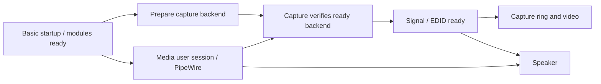

# Startup optimization: two prepared stages

Both stages are implemented and tested offline. **Subsequent update:** stage 1
is now installed following Chris's authorization; its first cold measurement
passed with a 5.21-second backend improvement. See the
[cold result](stage1-cold-result.md) and [installation record](stage1-installation.md).
**Stage 2 is now also installed after separate authorization; its first cold
measurement passed with 3.15 seconds earlier HDMI readiness.** See the
[stage-2 cold result](stage2-cold-result.md) and
[installation record](stage2-installation.md).
The preparation/rollout details below are retained.
Reviewable payloads, expected old identities, checksums and test logs are under
`local/recovery/2026-11-04-startup-optimization-preparation/`. Do not deploy by
copying that directory over the board: manifests, identity gates, backups,
shutdown ordering and a separately arranged boot test remain required.

## Why retain the MIPS checks?

The `help win` requests originated as bring-up diagnostics. They do not
configure MIPS or make the receiver clocks work. They demonstrate that the
firmware still processes a request after each staged clock change, before
DSP setup, and around teardown. Hardware reset-status and module parameters
alone cannot prove the firmware remains responsive.

The checks became production failure gates: a startup failure records the
attempt as failed, retains resource holds and refuses another startup on the
same boot. There is no evidence here qualifying their removal. Retain those
gates while making successful checks cheap. Consolidating stage checks later
would be a distinct change requiring clock/liveness failure evidence and
hardware qualification, rather than an assumed removal of old debug code.

## Stage 1: completion-aware IPC

Files: `tools/mips/mips-shell.py` and `tools/hdmi/h713-hdmi-session.py`.

The new opt-in `--check-ipc` transaction:

1. Takes a nonblocking advisory lock shared by cooperating command/drain CLI
   invocations. Contention fails before ring access; no command is queued.
2. Refuses parked firmware or an occupied command ring, then discards pending
   output before sending exactly `help win\r` once.
3. Polls with a monotonic 1.5-second deadline and 10-ms interval, returning
   as soon as it sees the complete pinned reply (echo, command help body and
   final prompt) and the down-ring request has been consumed. The reply is
   matched against the preserved 66-byte firmware response.
4. Returns a structured completion result, logged by the session to stderr
   for per-check latency measurements, or fails on timeout, malformed or
   oversized output. No retry, reset, clock change or shorter deadline is added.

The session requires that structured result rather than finding `VS:/`
somewhere in printed output, which previously could include discarded stale
output. All five startup stage checks remain. Legacy diagnostic `--cmd`
collection retains its fixed-duration behavior; it participates in the lock.
The lock protects cooperating uses of this CLI, not independent direct ring
writers. The pinned protocol has no transaction IDs; controlled boot-time
ownership remains required. Do not run a diagnostic shell concurrently with
the production startup transaction.

Tests cover the recorded reply, every split boundary, stale-only responses,
partial/incorrect replies, absent consumption, busy/parked firmware, deadline
expiry without retries, output bounds, malformed results and per-stage
startup failure retention. Simulated timings prove early return, not the
actual hardware response latency. Those timings must be measured on the board.

## Stage 2: overlap preparation and the user session

The new dependency-only `h713-hdmi-prepare.service` performs backend startup
after modules-load/basic prerequisites, alongside `user@1000.service`.
The existing capture service requires preparation, waits for both preparation
and the user session, and adopts only a verified ready session from the same
boot. Its existing startup invocation is idempotent: it checks state and
resources without repeating IPC or module/clock work.

Capture retains its `After=user@1000.service` relationship and terminal
`ExecStop`. On shutdown, signal/speaker/video stop before capture; capture's
teardown runs before the user session is stopped, so its WirePlumber
coordination remains available. Preparation has no teardown command and is
not independently enabled. A masked capture unit therefore does not pull
preparation into a local-playback boot. A failed preparation prevents capture
startup; existing partial-failure resource retention is preserved.

The full-image builder includes both unit copies and pulls preparation in
only through capture. The isolated systemd verifier checks the combined units;
ordering tests reject a new dependency back to the user session and reject
loss of the capture/user shutdown-order relationship. Lifecycle tests exercise
prepare → capture adoption without duplicate hardware operations. Actual
parallel-boot contention, failure recovery and shutdown remain hardware tests.

## PipeWire already starts at boot

The media account has lingering enabled in the rootfs recipe. The measured
RC boot starts its user manager at Linux 8.49 s and PipeWire at 11.584 s,
before the HDMI speaker starts at 23.124 s. Leave that user service enabled;
no extra system-wide PipeWire instance or new enable action is needed.
Preparation can run alongside the user manager, but playback still waits for
the PipeWire runtime and verified capture/signal readiness.

## Validation and proposed rollout

Offline results: 10 IPC transaction tests, 22 session lifecycle tests, six
release-packaging tests and two ordering/native-systemd tests pass. Nine
mutations are caught, including accepting a prompt without a reply, accepting
stale output, ignoring consumption/parked state/output bounds, accepting an
incomplete session result, independently enabling prepare, and damaging
parallel/shutdown ordering. No services were started by native validation.

Stage 1 first: review the exact two script payloads, compare the live boot ID
and both baseline script hashes, verify existing backend manifests, and
preserve original files/modes and manifest bytes in a host-verified rollback
backup. Update both scripts as one guarded installation and regenerate only
the affected backend manifest entries. Do not run the new IPC command on the
current board as an undocumented trial. Test on the next arranged cold boot,
capturing kernel/user/firmware timings and actual completion durations. Check
video, colour, audible content, DSP/receiver/EDID state and unchanged failure
guards; then qualify warm startup and clean shutdown. Keep the original RC
rollback artifacts immutable.

Stage 2 only after stage 1 passes: verify stage-1 identities, install matching
runtime/backend unit copies and the new prepare unit, and update the backend
manifest. Do not enable prepare directly or restart hardware owners. Validate
combined systemd dependencies before the next boot. Compare capture start,
user-manager readiness, backend-ready and HDMI-ready times, then exercise
warm boot and ordered shutdown, plus the isolated local-playback boot. Record
the host's first-advertisement/retry behavior separately so a missed initial
HDMI detection does not hide an improvement in backend startup.

No speedup is claimed until measured. The first stage does not remove all
7.5 seconds: it must still wait for actual responses. The second stage's
approximately 3.6-second overlap estimate is specific to the measured boot;
CPU/I/O contention and the capture adoption check may reduce it. They are
separate rollout stages to keep any regression attributable.
